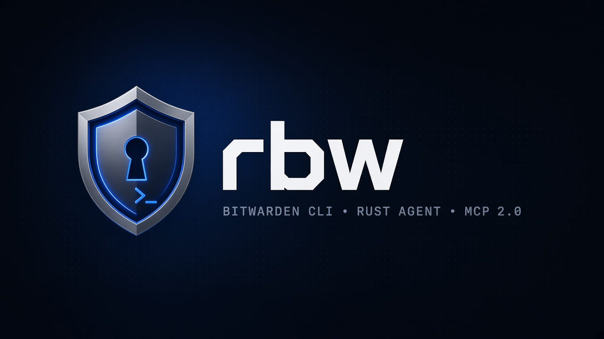

<p align="center">
  
</p>

<p align="center">
  <strong>Unofficial Bitwarden &amp; Vaultwarden CLI in Rust</strong><br />
  Persistent background agent · Multi-account vaults · Touch ID &amp; FIDO2/YubiKey · SSH agent · Local MCP 2.0 server
</p>

<p align="center">
  <a href="https://github.com/nguyenthdat/rbw/actions/workflows/tests.yaml"></a>
  <a href="https://github.com/nguyenthdat/rbw/releases"></a>
  <a href="LICENSE"></a>
  
  
</p>

<p align="center">
  <a href="#quick-start">Quick Start</a> ·
  <a href="#installation">Installation</a> ·
  <a href="#multiple-accounts--profiles">Multi-Account</a> ·
  <a href="#biometrics-fido2--passkeys">Touch ID &amp; FIDO2</a> ·
  <a href="#mcp-server-model-context-protocol-20">MCP 2.0 Server</a> ·
  <a href="#configuration">Configuration</a>
</p>

---

Unlike the official stateless Bitwarden CLI (which requires manually unlocking and passing `BW_SESSION` environment variables around), `rbw` runs a lightweight background daemon (`rbw-agent`) that keeps decrypted keys in locked memory (`mlock`), similar to `ssh-agent` or `gpg-agent`.

## Highlights

| Capability | Details |
| :--- | :--- |
| **Persistent Agent** | Automatic login, unlock, timeout locking, and background WebSocket sync via `rbw-agent`. |
| **Multi-Account & Profiles** | Manage multiple Bitwarden Cloud (`.com` / `.eu`) and self-hosted Vaultwarden accounts in one agent (`rbw switch`, `-a/--account`, `RBW_ACCOUNT`), plus isolated `RBW_PROFILE` environments. |
| **Touch ID & FIDO2 / Passkeys** | Local vault unlock via macOS Touch ID / Apple Watch or CTAP2 `hmac-secret` YubiKeys, plus passwordless WebAuthn PRF passkey login (`rbw login --passkey`). |
| **Complete Vault Operations** | Logins, TOTP / Steam Guard, Secure Notes, Password History (`rbw history`), encrypted File Attachments (Bitwarden Cloud Azure SAS &amp; Vaultwarden Direct), and Diceware/password generation. |
| **Built-in SSH Agent** | Serve SSH key vault entries directly over `$XDG_RUNTIME_DIR/rbw/ssh-agent-socket` for the active account. |
| **Local MCP 2.0 Server** | Zero-token stdio MCP 2.0 (`2026-07-28`) server (`rbw mcp`) with clipboard-only secret delivery, opt-in writes, allowlisted attachment transfers, and a bundled SEP-2640 Agent Skill. |
| **Standalone Installer & Self-Update** | One-line POSIX `curl` installer and atomic `rbw self update` with mandatory SHA-256 verification. |

## Quick Start

```sh
# 1. Install prebuilt rbw + rbw-agent (macOS & Linux)
curl -LsSf https://github.com/nguyenthdat/rbw/releases/latest/download/install.sh | sh

# 2. Configure an account (interactive wizard for bitwarden.com, bitwarden.eu, or self-hosted)
rbw account add

# 3. Retrieve passwords or TOTP codes (unlocks automatically via Touch ID / YubiKey / pinentry)
rbw get github --clipboard
rbw code github

# 4. Upgrade anytime from GitHub Releases
rbw self update
```

> [!NOTE]
> **Official Bitwarden server (`bitwarden.com`) users:** Bitwarden Cloud may flag initial CLI password logins as bot traffic (see [bitwarden/cli#383](https://github.com/bitwarden/cli/issues/383)). Run `rbw register` once per device using your [personal API key](https://bitwarden.com/help/article/personal-api-key/) before regular logins.

## Installation

### Standalone Installer (macOS & Linux)

Install prebuilt `rbw` and `rbw-agent` binaries (with SHA-256 checksum verification) via `curl` or `wget`:

```sh
curl -LsSf https://github.com/nguyenthdat/rbw/releases/latest/download/install.sh | sh
```

Install a pinned version or customize the target directory:

```sh
# Install a specific release tag
curl -LsSf https://github.com/nguyenthdat/rbw/releases/download/v1.16.1/install.sh | sh

# Or pass flags / environment variables
curl -LsSf https://github.com/nguyenthdat/rbw/releases/latest/download/install.sh | sh -s -- --version 1.16.1 --install-dir ~/.local/bin
curl -LsSf https://github.com/nguyenthdat/rbw/releases/latest/download/install.sh | RBW_NO_MODIFY_PATH=1 sh
```

- **macOS:** Supports Apple Silicon (`aarch64-apple-darwin`) and Intel (`x86_64-apple-darwin`) with automatic Rosetta 2 detection.
- **Linux:** Supports `x86_64` and `aarch64`. Automatically selects `gnu` (with native FIDO2/YubiKey support) when `glibc >= 2.39`, and falls back to static `musl` binaries on Alpine or older glibc systems (`RBW_INSTALL_LIBC=musl|gnu` overrides this).
- **Requirement:** Install [`pinentry`](https://www.gnupg.org/related_software/pinentry/index.en.html) (e.g. `brew install pinentry-mac` on macOS or `sudo apt install pinentry-curses` on Debian/Ubuntu) for master password prompts.

### Self-Update

Upgrade an existing standalone installation directly from GitHub Releases (verifies SHA-256, smoke-tests the staged binary, stops any running `rbw-agent`, and atomically swaps both `rbw` and `rbw-agent`):

```sh
rbw self update                  # Update to the latest release (alias: rbw self-update)
rbw self update --check          # Check whether a newer version is available
rbw self update --version 1.16.1 # Install a specific version
rbw self update --force          # Reinstall even if already up to date
```

### Build from Source / Other Packages

```sh
# Build this fork from source (Rust 1.100+)
cargo install --locked --git https://github.com/nguyenthdat/rbw.git
```

<details>
<summary>Debian (.deb) &amp; Upstream Distribution Packages (<code>doy/rbw</code>)</summary>

Prebuilt `amd64` `.deb` packages for this fork are attached to each [GitHub Release](https://github.com/nguyenthdat/rbw/releases).

Upstream [`doy/rbw`](https://github.com/doy/rbw) is also packaged in system repositories (note: upstream distro packages may not include fork-specific features such as Touch ID, FIDO2/YubiKey, multi-account, attachments, or MCP 2.0):

| Platform | Command |
| :--- | :--- |
| Arch Linux | `pacman -S rbw` ([extra](https://archlinux.org/packages/extra/x86_64/rbw/)) or `rbw-git` (AUR) |
| Debian / Ubuntu | `sudo apt install rbw` (testing/forky) or `.deb` from [releases](https://github.com/nguyenthdat/rbw/releases) |
| Fedora / EPEL 9 | `sudo dnf install rbw` |
| Homebrew | `brew install rbw` |
| Nix | `nix-shell -p rbw` |
| Alpine | `apk add rbw` |

</details>

## Multiple Accounts & Profiles

Manage and switch between multiple Bitwarden / Vaultwarden accounts (including the same email across different vault servers) inside a single `rbw-agent`:

```sh
# Interactive wizard (supports bitwarden.com, bitwarden.eu, or self-hosted URLs)
rbw account add

# Non-interactive account setup
rbw account add work --email user@example.com --server https://vault.example.com
rbw account add personal --email user@example.com --server bitwarden.com --login

# List configured accounts and live lock status (aliases: ls, status)
rbw account list

# Switch active account interactively (arrow-key picker) or directly
rbw switch
rbw switch personal
rbw account switch --email user@example.com --server bitwarden.com

# Run a single command against another account without switching
rbw -a work ls
RBW_ACCOUNT=personal rbw get github

# Lock the active account or every account at once
rbw lock
rbw lock --all

# Rename or remove an account (--keep-data retains local DB/Touch ID/YubiKey keys)
rbw account rename personal bw
rbw account remove bw
```

Switching accounts keeps previously unlocked accounts unlocked in `rbw-agent` memory until their individual `lock_timeout` expires or `rbw lock` / `rbw lock --all` is run. Per-account configuration overrides use `rbw config set` (global defaults use `rbw config set --global`). Existing single-account `config.json` files migrate automatically.

For completely isolated config, cache, runtime sockets, and separate `rbw-agent` daemons, set `RBW_PROFILE` (e.g. `RBW_PROFILE=work`).

## Usage

Commands automatically log in or unlock as needed: `rbw ls` unlocks the local database, `rbw sync` logs in and refreshes the vault, and `rbw add` does both. Run `rbw help` for the full command reference.

```sh
rbw ls --fields name,user,folder        # List entries (tab-separated, or --raw JSON)
rbw search github                       # Search across name, username, URI, and notes
rbw get github                          # Print password (matches name, UUID, or URL)
rbw get github --full                   # Include username, notes, and custom fields
rbw get github --field username         # Extract a specific default or custom field
rbw get github --raw                    # Output entry as JSON
rbw code github --clipboard             # Copy live TOTP code (alias: rbw totp)
rbw gen 24 --nonconfusables             # Generate a password (or --diceware 5)
rbw edit github                         # Edit password & notes in $VISUAL / $EDITOR
rbw lock && rbw stop-agent              # Lock vault or shut down the background agent
rbw purge                               # Log out and delete local encrypted cache
```

### Password History & Secure Notes

View password versions chronologically from oldest (`v1`) to current:

```sh
rbw history <entry>
rbw history <entry> --raw
rbw history <entry> --version 1
rbw history <entry> --version current --clipboard
```

Create a Secure Note via `$EDITOR` or piped `stdin` (piped `stdin` preserves leading `#` lines such as Markdown headings):

```sh
rbw add --note "My Secret Note" --folder personal
printf '# Runbook\nSecret steps\n' | rbw add --type note "Runbook"
```

### Attachments

Run `rbw sync` to refresh attachment metadata. Supports both Bitwarden Cloud Azure SAS uploads and Vaultwarden / self-hosted Direct uploads:

```sh
# List attachments
rbw attachment list <entry>
rbw attachment list <entry> --raw

# Upload an attachment (file path or stdin with --name)
rbw attachment upload <entry> --file ./document.pdf
cat secret.key | rbw attachment upload <entry> --file - --name secret.key

# Download an attachment (atomic 0600, no-clobber, refuses binary to TTY)
rbw get <entry> --attachment document.pdf --output ./document.pdf
rbw get <entry> --attachment <attachment-id> --output - > ./document.pdf
rbw attachment download <entry> --attachment document.pdf --output ./document.pdf

# Remove an attachment
rbw attachment remove <entry> --attachment document.pdf
```

All standard selectors (username, `--folder`, `--ignorecase`, `-a/--account`) apply. Duplicate filenames require an attachment ID. Attachment operations honor master-password reprompt.

### SSH Agent

`rbw-agent` includes a built-in SSH agent serving SSH key entries for the active account:

```sh
rbw unlock
export SSH_AUTH_SOCK="$XDG_RUNTIME_DIR/rbw/ssh-agent-socket"
```

When using `RBW_PROFILE`, the socket lives at `"$XDG_RUNTIME_DIR/rbw-<profile>/ssh-agent-socket"`.

## Biometrics, FIDO2 & Passkeys

- **macOS Touch ID:** Enable with `rbw config set touchid true`. Stores only the derived 64-byte master key (never your master password) in the macOS login keychain, falls back to `pinentry` automatically, and clears keys when disabled or on `rbw purge`.
- **FIDO2 / YubiKey Local Unlock:** Enable with `rbw config set yubikey true` and enroll one or more keys via `rbw yubikey enroll` (`list`, `remove`, `clear`). Uses CTAP2 `hmac-secret` to wrap the derived master key (`0600` ciphertext in `data_dir`). Require PIN/biometric UV with `rbw config set yubikey_uv true`.
- **Passwordless Passkey Login:** Run `rbw login --passkey` (or set `rbw config set passkey_login true`) to authenticate with WebAuthn PRF vault decryption on servers supporting `grant_type=webauthn` (official Bitwarden Cloud).
- **2FA Support:** Email, Authenticator App (TOTP), Yubico OTP, and native FIDO2 / WebAuthn over USB HID (macOS &amp; Linux; Duo is unsupported). On Linux, native FIDO2 uses `hidraw` and requires udev permissions (handled automatically by modern `systemd` or `libfido2` udev rules).

> [!NOTE]
> Vault entries flagged with **Master Password Re-prompt** always require your master password via `pinentry`, even when Touch ID or YubiKey unlock is enabled.

## MCP Server (Model Context Protocol 2.0)

`rbw` ships a local-only **MCP 2.0 (`2026-07-28`)** stdio server backed by `rbw-agent` (enabled by the default `mcp` feature). It requires no `BW_SESSION` token in client configs, supports multi-account vaults, and triggers local Touch ID / YubiKey / `pinentry` out-of-band on unlock.

| Mode | Activation | Exposed Tools |
| :--- | :--- | :--- |
| **Read-only (default)** | `rbw mcp` | `vault_status`, `vault_search` (metadata only), `vault_get` (`summary`, `field`, `totp`, `history`, `full`, `copy_to_clipboard`), `vault_generate`, `vault_session` (`unlock`, `lock`, `sync`, `switch_account`) |
| **Write & Delete** | `--allow-write` or `RBW_MCP_ALLOW_WRITE=1` | `+ vault_write` (`create_item`, `update_item`, `create_folder`), `vault_delete` (`item`, `attachment`, `destructiveHint: true`) |
| **Attachments** | `--allowed-dir <DIR>` or `RBW_MCP_ALLOWED_DIRS` | `+ vault_attachment` (`download` atomic `0600` no-clobber; `upload` also requires `--allow-write`) |

Example MCP client configuration (read-only):

```json
{
  "mcpServers": {
    "rbw": {
      "command": "rbw",
      "args": ["mcp"]
    }
  }
}
```

With opt-in writes and a dedicated attachment directory:

```json
{
  "mcpServers": {
    "rbw": {
      "command": "rbw",
      "args": ["mcp", "--allow-write", "--allowed-dir", "/tmp/rbw-attachments"]
    }
  }
}
```

### Bundled Agent Skill

`rbw` bundles an Agent Skill (`skills/rbw/`) in two ways:

1. **MCP 2.0 SEP-2640 (`io.modelcontextprotocol/skills`):** `rbw mcp` serves `skill://rbw/SKILL.md` and references natively over `skills/list`, `skills/get`, `resources/list`, `resources/read`, and `resources/directory/read` with SHA-256 digests.
2. **Local installation for agent runtimes:**

```sh
rbw mcp install-skill --target agents   # ~/.agents/skills/rbw (default)
rbw mcp install-skill --target agy      # ~/.gemini/config/skills/rbw
rbw mcp install-skill --target omp      # ~/.omp/agent/skills/rbw
rbw mcp install-skill --target claude   # ~/.claude/skills/rbw
rbw mcp install-skill --target all --force
```

## Configuration

Inspect or modify settings with `rbw config show`, `rbw config set <key> <value>`, and `rbw config unset <key>` (add `--global` for global defaults):

| Option | Default | Description |
| :--- | :--- | :--- |
| `email` | *(required)* | Account email address for Bitwarden / Vaultwarden login. |
| `sso_id` | *(unset)* | SSO organization ID (defaults to standard login if unset). |
| `base_url` | `https://api.bitwarden.com/` | Bitwarden / Vaultwarden server base URL. |
| `identity_url` | `<base_url>/identity` or `https://identity.bitwarden.com/` | Identity server URL. |
| `ui_url` | `https://vault.bitwarden.com/` | Web vault UI URL. |
| `notifications_url` | `<base_url>/notifications` or `https://notifications.bitwarden.com/` | WebSocket notifications server URL. |
| `lock_timeout` | `3600` | Seconds to keep master keys in memory before auto-locking. |
| `sync_interval` | `3600` | Background vault sync interval in seconds (`0` disables periodic sync). |
| `pinentry` | `pinentry` | Executable used for password prompts (e.g. `pinentry-mac`, `pinentry-curses`). |
| `touchid` | `false` | *(macOS only)* Unlock local vault using Touch ID / Apple Watch. |
| `yubikey` | `false` | Unlock local vault using enrolled FIDO2 / YubiKey security keys (`hmac-secret`). |
| `yubikey_uv` | `false` | Require FIDO2 User Verification (PIN / biometric) on local YubiKey unlock. |
| `passkey_login` | `false` | Default `rbw login` to passwordless WebAuthn PRF passkey login. |

## Shell Completions

Generate shell completions (including dynamic entry/account completion for `bash`, `zsh`, and `fish`):

```sh
rbw gen-completions zsh  > ~/.zfunc/_rbw
rbw gen-completions bash > ~/.local/share/bash-completion/completions/rbw
rbw gen-completions fish > ~/.config/fish/completions/rbw.fish
```

Also supports `powershell`, `elvish`, `nushell`, and `fig`.

## Related Projects

- [rofi-rbw](https://github.com/fdw/rofi-rbw) — Rofi frontend for Bitwarden
- [bw-ssh](https://framagit.org/Glandos/bw-ssh/) — Manage SSH key passphrases in Bitwarden
- [rbw-menu](https://github.com/rbuchberger/rbw-menu) — Tiny menu picker for `rbw`
- [ulauncher-rbw](https://0xacab.org/varac-projects/ulauncher-rbw) — Ulauncher `rbw` extension
- [fuzzel-rbw](https://github.com/sammhansen/fuzzel-rbw) — Fuzzel frontend for Bitwarden

## Credits & License

Originally created by [Jesse Luehrs (`doy/rbw`)](https://github.com/doy/rbw), extended with multi-account, Touch ID, FIDO2/YubiKey, attachments, password history, MCP 2.0, and standalone release tooling.

Licensed under the [MIT License](LICENSE).
